<!-- HEADER -->

 

&nbsp;&nbsp;

---

## Sobre mí

Soy **Ingeniero de Software** (egreso en agosto de 2026) con **un año de experiencia profesional** construyendo funcionalidades **full-stack**: desde la fuente de datos, pasando por la API, hasta la interfaz de usuario.

Me gusta que el software sea **claro, probado y útil**. Trabajo con un proceso guiado por especificaciones, reviso la calidad antes de cada pull request y disfruto convertir tareas repetitivas en **flujos automatizados**.

> **Me interesa:** Inteligencia Artificial · Ingeniería de Datos · Automatización de flujos de trabajo

| Ahora mismo | Aprendiendo | Pregúntame sobre |
|:---|:---|:---|
| Plataformas multi-servicio, reportes y análisis de datos | IA aplicada, ingeniería de datos y AWS | Full-stack, automatización, Scrum |

---

## Stack tecnológico

**Lenguajes**&nbsp;&nbsp;      

**Backend**&nbsp;&nbsp;    

**Frontend**&nbsp;&nbsp;    

**Datos, Cloud y DevOps**&nbsp;&nbsp;     

---

## Experiencia

### Practicante de Ingeniería de Software · Plataforma de IA · *Nov 2025 – Actualidad* · Remoto

- Desarrollo de funcionalidades **de punta a punta** (datos, API e interfaz) en una plataforma de varios servicios con **NestJS, FastAPI, React/Next.js y TypeScript**, con proceso guiado por especificaciones.
- Diseño y consulta de modelos relacionales en **PostgreSQL** (Prisma, SQLAlchemy, Alembic), incluyendo **migraciones** y acceso a datos para reportes.
- Vistas de reportes en el front-end (React, TanStack Query, shadcn/ui) para **seguimiento de metas y resúmenes del embudo de leads**.
- Análisis de **uso y costos de infraestructura en AWS**, identificando y explicando diferencias entre tableros; trabajo con **SageMaker** y **trabajos programados** para procesamiento recurrente de datos.
- Pruebas automatizadas, verificaciones de calidad antes de cada pull request y **Docker** para entornos locales.

### Aprendiz de Software · Laboratorio de investigación · *Mar 2024 – Jul 2025*

- Desarrollé una aplicación en **Python** que automatiza la generación de formatos para publicación académica digital.
- Colaboré con investigadores para optimizar sus flujos de publicación.

### Voluntario · Proyecto de Análisis de Datos · *Jul – Ago 2022*

- Análisis de datos, gráficas estadísticas y conclusiones con herramientas de cálculo y visualización.

---

## Certificaciones y metodologías

**Metodologías:** Scrum · Gestión ágil de proyectos · BPM · Design Thinking · Lean Change Management

**Habilidades blandas:** Comunicación · Trabajo en equipo · Resolución de problemas · Adaptabilidad · Negociación

**Idiomas:** Español (nativo) · Inglés (profesional)

---

## Estadísticas de GitHub

  

  

  
  

---

## Contacto

Si tienes un proyecto, una vacante o quieres colaborar, escríbeme por LinkedIn:

